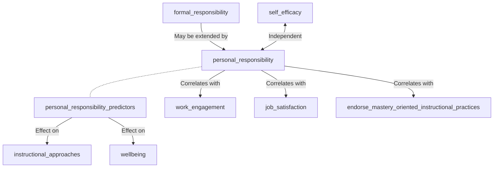
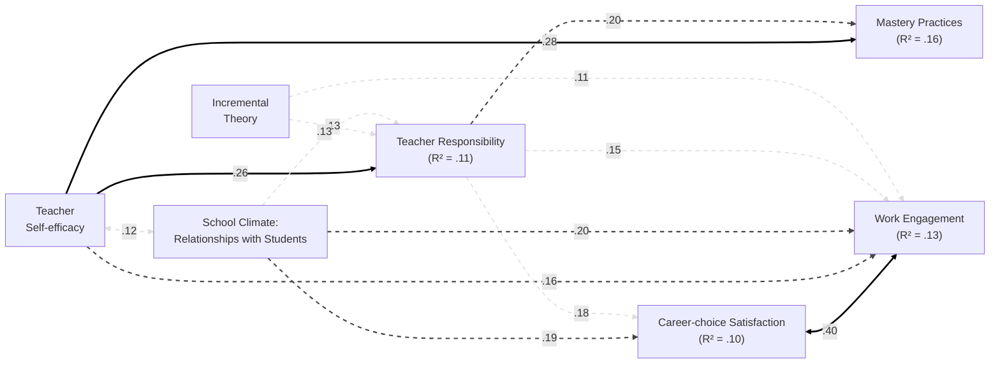

---
tags:
  - notes
  - 2026-11-26
---

# 2026-11-26

- Date: 2026-11-26
- Lead discussion: Richel Bilderbeek
- Paper: Matteucci, M.C., Guglielmi, D. & Lauermann, F. Teachers’ sense of responsibility for educational outcomes and its associations with teachers’ instructional approaches and professional wellbeing. Soc Psychol Educ 20, 275–298 (2017). [DOI](https://doi.org/10.1007/s11218-017-9369-y)


## Discussion

Talk: why I chose this paper

???- question "Answers"

    I wanted to know if reading the literature to improve teaching is worth it:
    to which extent does it make one a better teacher.


???- question "Questions I will ask as an easy copy-paste"


    ```text
    1. What grade on a scale from 1 (worst) to 10 (best) would you give this paper?
    2. How would you summarize this paper in one line?
    3. How would you praise the paper?
    4. How would you criticise the paper?
    5. Do you believe that we should do what this paper advises?
    6. How does this paper make us better teachers?
    ```

What grade on a scale from 1 (worst) to 10 (best) would you give this paper?

???- question "Answers"

    - R: 5
    - ...
    - ...


How would you summarize this paper in one line?

???- question "Answers"

    - R: Teachers feeling responsible has some effects on some things

How would you praise the paper?

???- question "Answers"

    - R: I enjoyed the introduction and the .
    - ...
    - ...
    - ...

How would you criticise the paper?

???- question "Answers"

    - R: The data, nor the data analysis scripts are not available for download.
      Using a p-value of 0.1 to get 'a result' feels dishonest to me.

    - ...
    - ...
    - ...


<!-- Extra question -->
Do you feel that we are formally/professionally responsible
for the learning of our participants? Why?


Do you believe that we should do what this paper advises?

???- question "Answers"

    - R: This paper gives no advice, it only charts what is there
    - ...
    - ...
    - ...


How does this paper make us better teachers?

???- question "Answers"

    - R: There is no need to feel personally responsible: the effect is mild.
    - ...
    - ...
    - ...


##

Even though this paper plots the relationships between some things,
it does not answer the question: 'Are we responsible for the
learning or motivation of our participants?'.

On the other hand, you could say, following this paper: 'No, we
only have our formal responsibilities'. I have scanned the SLL and NBIS
Training Hubs and could not find any document to state we need to do more.


## Scribbles 1



- Efficacy: well something works, i.e. how well it produces the intended result.
  For example: 'one-on-one teaching has a higher efficacy in producing high
  grades than classroom teaching'
- Mastery-goal classroom structure: a learning environment that emphasizes
  understanding, improvement, and developing skills, i.e.
  competetion with self, not others

My questions:

- Why is it important that teachers feel responsible beyond their formal duties?
  Why are the formal duties not extended instead?


What is this text below..?

> Expanding upon previous qualitative research, which had used
> teacher interview data (Lautheir general choiceermann 2014)


Teacher Responsibility Scale (TRS, Lauermann and Karabenick 2013)
has four domains:
- responsibility for student motivation
- student achievement
- relationships with students
- (responsibility for) teaching


| Aspect                           |    1    |     2     |    3    |    4    |     5     |     6     |     7     |    8    |     9     |
|:-------------------------------- |:-------:|:---------:|:-------:|:-------:|:---------:|:---------:|:---------:|:-------:|:---------:|
| 1. Responsibility                |    /    |  **.29**  |   .17   |   .18   |  **.24**  |  **.25**  |  **.30**  |         |    -.21   |
| 2. Self-efficacy                 |         |     /     |         |         |    .18    |  **.24**  |  **.34**  |         |           |
| 3. Incremental theory            |         |           |    /    |         |           |    .18    |    .17    |         |           |
| 4. Relationships with students   |         |           |         |    /    |  **.23**  |  **.25**  |           |         |           |
| 5. Career-choice satisfaction    |         |           |         |         |     /     |  **.47**  |  **.21**  |         |           |
| 6. Work engagement               |         |           |         |         |           |     /     |  **.24**  |         |           |
| 7. Mastery practices             |         |           |         |         |           |           |     /     |         |           |
| 8. Age                           |         |           |         |         |           |           |           |    /    |  **.75**  |
| 9. Teaching experience           |         |           |         |         |           |           |           |         |     /     |

> Top part of Table 1 from Matteucci, Guglielmi, & Lauermann (2017),
> presenting bivariate correlations between the 9 aspects.
> Values with **p < 0.001** are rendered in **bold**.
> Values with **p < 0.01** are rendered in normal text.




Mastery learning has an effect size of 0.57 [John Hattie]

## Scribbles 2


<!-- markdownlint-disable MD013 --><!-- Not now ... -->

Imagine a teacher that teaches short workshops in higher education. Imagine that that teacher has the view that the learners are the sole responsible for their learning (i.e. the teacher has no responsibility to motivate the learners). Which papers investigate such a teacher's view? Is there a name for such a view on teaching? What causes such a view on teaching?

The closest name is a teacher-centered, transmission view; it treats learner autonomy as mainly the student’s job.
The papers split into three parts: which studies examine this view, what the view is usually called, and what seems to produce it.

Papers Investigating It

No paper here studies exactly the extreme claim that teachers have no responsibility to motivate learners, but several investigate closely related beliefs in higher education.

- Borg, S., & Alshumaimeri, Y. (2017). Language learner autonomy in a tertiary context: Teachers’ beliefs and practices. Language Teaching Research, 23, 38 - 9. <https://doi.org/10.1177/1362168817725759>
- Lauermann, F., & Berger, J.-L. (2021). Linking teacher self-efficacy and responsibility with teachers’ self-reported and student-reported motivating styles and student engagement. Learning and Instruction, 101441. <https://doi.org/10.1016/j.learninstruc.2020.101441>
- Russell, J. M., Baik, C., Ryan, A., & Molloy, E. (2020). Fostering self-regulated learning in higher education: Making self-regulation visible. Active Learning in Higher Education, 23, 97 - 113. <https://doi.org/10.1177/1469787420982378>

The clearest direct match is work on learner autonomy beliefs, where teachers often define autonomy as students taking responsibility and control with little teacher involvement, and many explain weak autonomy mainly by student deficits such as low motivation or poor learning skills.

- Borg, S., & Alshumaimeri, Y. (2017). Language learner autonomy in a tertiary context: Teachers’ beliefs and practices. Language Teaching Research, 23, 38 - 9. <https://doi.org/10.1177/1362168817725759>

Several higher-education studies examine teacher-centered or transmission conceptions in which the teacher’s role is to impart information and student sense-making is left largely to students.

- Päuler-Kuppinger, L., & Jucks, R. (2017). Perspectives on teaching: Conceptions of teaching and epistemological beliefs of university academics and students in different domains. Active Learning in Higher Education, 18, 63 - 76. <https://doi.org/10.1177/1469787417693507>
- Rozhenkova, V., Snow, L., Sato, B. K., Lo, S. M., & Buswell, N. (2023). Limited or complete? Teaching and learning conceptions and instructional environments fostered by STEM teaching versus research faculty. International Journal of STEM Education, 10, 1-20. <https://doi.org/10.1186/s40594-023-00440-9>
- Kember, D. (1997). A reconceptualisation of the research into university academics' conceptions of teaching. Learning and Instruction, 7, 255-275. <https://doi.org/10.1016/s0959-4752(96)00028-x>
- Prosser, M., & Trigwell, K. (2014). Qualitative variation in approaches to university teaching and learning in large first-year classes. Higher Education, 67, 783-795. <https://doi.org/10.1007/s10734-013-9690-0>

The limited-to-complete continuum of teaching conceptions is summarized visually in a department-level figure showing how limited conceptions align with instructor-centered environments.


- Rozhenkova, V., Snow, L., Sato, B. K., Lo, S. M., & Buswell, N. (2023). Limited or complete? Teaching and learning conceptions and instructional environments fostered by STEM teaching versus research faculty. International Journal of STEM Education, 10, 1-20. <https://doi.org/10.1186/s40594-023-00440-9>
