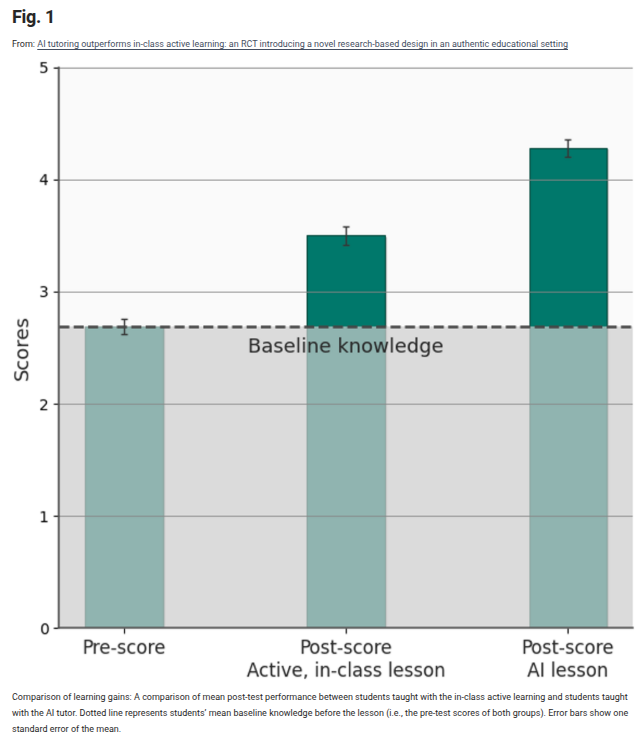

---
tags:
  - notes
  - 2026-12-17
---

# 2026-12-17

- Date: 2026-12-17
- Lead discussion: Richel Bilderbeek
- Paper: ...

## Misleading

Figure 1 is misleading:

Figure 1 suggests that there is no difference in initial skill
per category (i.e. active learning versus AI)

Plotting the initial skills per category
shows that the AI people have a higher initial skill:

If we plot the skill change per category,
we see no relevant difference anymore:

